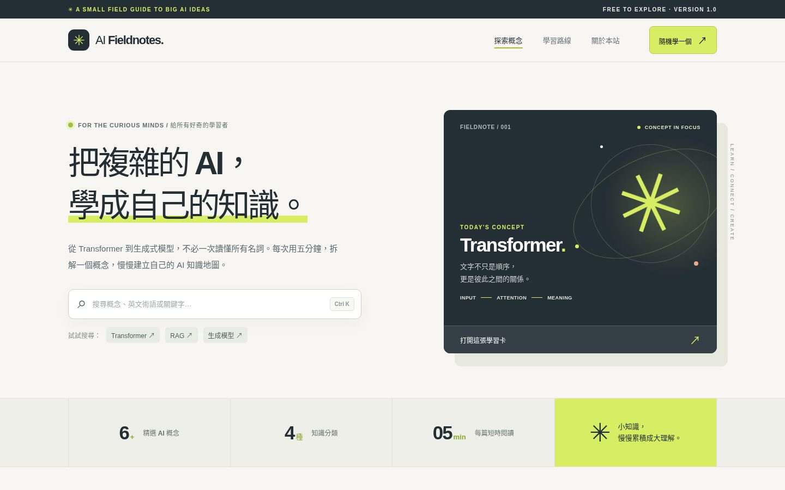
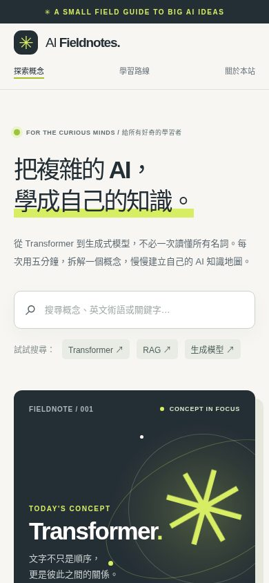

# ✳ AI Fieldnotes — AI 概念學習卡

**「把複雜的 AI，學成自己的知識。」**

這是一個使用 **AGENTS.md 規則驅動開發** 的生成式 AI 入門知識庫，讓不同 AI 都能用同一個資料模型持續新增文章，而不是每次重新生成一份網頁。

## 網站預覽





## 功能

- **首頁：** 六個原創 AI 概念：Transformer、LLM、擴散模型、GAN、RAG、提示詞設計。
- **探索工具：** 即時關鍵字搜尋、四種類別篩選、收藏（localStorage）、隨機推薦。
- **共用教學頁：** 一句話理解、生活比喻、三步運作機制、實際應用、常見誤解、英文術語及四選一互動測驗。
- **學習路線：** 三階段的自主學習建議。
- **關於本站：** 說明 AGENTS.md 與 AI 如何持續擴充網站。
- **無框架、無外部 API：** 純原生 HTML/CSS/JavaScript，支援手機、平板與桌機。

## 專案結構

```text
AGENTS.md                 AI 協作規範（最重要）
README.md                 專案介紹與部署說明
SUBMISSION.md             課堂作業繳交範本
index.html                首頁
topic.html                概念詳細教學共用模板
about.html                開發規範與網站介紹
data/topics.js            所有概念內容資料
assets/styles.css         全站樣式
assets/shared.js          共用工具／收藏功能
assets/app.js             首頁篩選搜尋
assets/topic.js           詳細頁面／測驗互動
images/favicon.svg        網站圖示
images/preview-*.jpg      首頁展示截圖
tests/validate-content.mjs 檔案及資料驗證
.nojekyll                 停用 Jekyll 處理
```

## 本機使用

需要 Python 3（網站）及 Node.js 18+（資料驗證）。不需要安裝任何 npm 套件。

```bash
node tests/validate-content.mjs
python -m http.server 8000
```

用瀏覽器開啟 `http://localhost:8000`。首頁與六篇文章可以直接瀏覽；例如：

- `http://localhost:8000/topic.html?slug=transformer`
- `http://localhost:8000/topic.html?slug=diffusion-model`
- `http://localhost:8000/topic.html?slug=rag`

## GitHub Pages 發布（無需指令）

1. 登入 GitHub，開啟 [New repository](https://github.com/new)。
2. Repository name 輸入 **`ai-fieldnotes`**；Visibility 選擇 **Public**；建立儲存庫。
3. 在儲存庫中選擇 **Add file → Upload files**。上傳本專案資料夾**裡面**的所有檔案與子資料夾，而不是把 ZIP 當成單一檔案上傳。確保 `index.html`、`AGENTS.md` 與 `README.md` 位於儲存庫**最外層**。提交至 `main` 分支。
4. 進入 **Settings → Pages**；在 **Build and deployment** 中，將 Source 設為 **Deploy from a branch**，Branch 選 **main**、Folder 選 **/(root)**，儲存。
5. 待 GitHub 完成 Pages 部署，按 **Visit site**，或開啟 `https://你的GitHub帳號.github.io/ai-fieldnotes/`。請**實際測試網頁可瀏覽**後，再將網址填入作業。
6. 之後修改 `main` 分支的內容，GitHub Pages 會依設定自動重新發布。

> ⚠️ 此 ZIP 是可部署專案，不代表已自動建立 GitHub 儲存庫。公開 Repo 網址與網站網址，必須以你實際建立並驗證的網址為準。

## AI 如何擴充？

想加新主題，例如「AI Agent」時，請對 AI 說：

> 請先閱讀 `AGENTS.md`，依照專案規則新增「AI Agent」概念。不要更動既有文章。加入資料後執行 `node tests/validate-content.mjs`，並檢查首頁卡片、分類、搜尋、文章內容與測驗都能使用。

AI 依照 `AGENTS.md` 規則，僅需擴充 `data/topics.js` 的新物件，即會自動產生首頁卡片及 `topic.html?slug=ai-agent` 教學頁面；不用重寫頁面。

## 內容與用途

教學內容為本專案撰寫的原創入門解說，供學習與作業展示使用。概念簡化僅供入門，不替代教科書或論文；重要細節應進一步查閱可靠資料。使用者的收藏僅保存在自己的瀏覽器，沒有上傳到任何伺服器。
